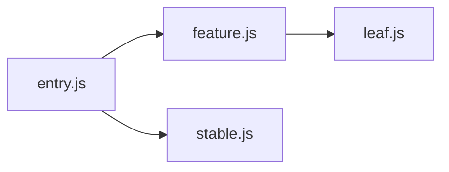
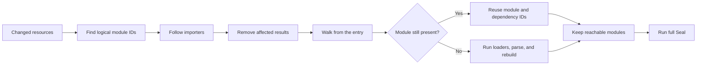
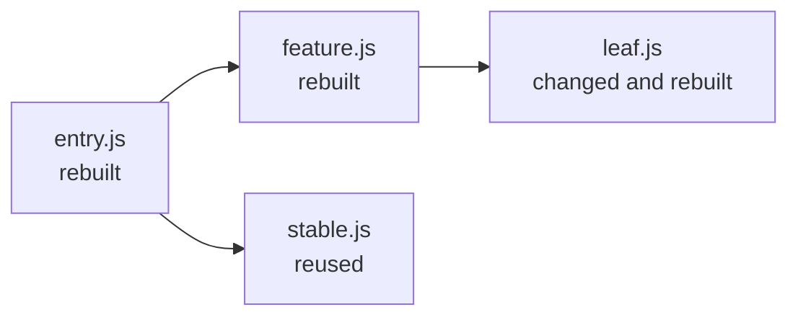

## A changed file is not an invalidation model

At the end of [the watch mode chapter](/posts/feopack-watch-mode/), Feopack could keep running, collect changed and removed file paths, and schedule another build. Its dependency coverage and error recovery were still limited.

It also threw away every useful result from the previous build.

That made the next feature sound deceptively mechanical:

```text
if a file did not change:
  do not rebuild it
```

But what exactly is “it” in that sentence?

A file is not always a module. A module may be created from a file plus a query, a particular loader chain, or a virtual request generated by another loader.

And even if one module changes, the compiler may no longer be able to trust the modules that imported it.

Incremental compilation therefore begins with a question about evidence, not speed:

> Why are we allowed to reuse this result?

:::commit-trail{title="Implementation snapshot · 1 commit"}
- [`4dab860`](https://github.com/atom-universe/feopack/commit/4dab860f99363574f82bd9929c1313bc92406cb5) — preserve the previous module graph, invalidate affected modules, rebuild from the entry, and reuse an unaffected branch
:::

> This chapter records the incremental `make` implemented in the commit above. The watch loop is still an early implementation, and `seal` still runs in full. The final section is a placeholder for a future write-up once the implementation is ready.

## 1. What did the watcher actually tell us?

The JavaScript scheduler already had two sets:

```ts
compiler.modifiedFiles = new Set(changedFiles)
compiler.removedFiles = new Set(removedFiles)
```

Those values crossed NAPI through a new native `rebuild(modifiedFiles, removedFiles)` method. That solved the transport problem. It did not yet tell Rust which module records were unsafe to reuse.

My first instinct was to look up each path in the module graph and remove the matching module. That would have worked in the earliest version of Feopack. By this point, it was already the wrong model.

Consider a single-component file:

```text
/src/App.meow-v3
/src/App.meow-v3?type=script&lang=ts
/src/App.meow-v3?type=style&scoped
```

The three strings can identify three logical modules, while every one of them reads from the same physical resource.

If `/src/App.meow-v3` changes, looking it up in a map keyed only by module ID will miss the virtual blocks.

Earlier Feopack code had used a file path as the module identity. The loader chapters broke that convenient equivalence for a good reason: a request ID can preserve queries and inline loader syntax that an operating-system path cannot represent.

Now the file path had to return, but in a different role.

## 2. Bringing file paths back without making them identities

The module graph kept its primary map keyed by module ID and added a secondary index:

```rust
pub struct ModuleGraph {
  modules: HashMap<String, Module>,
  modules_by_resource: HashMap<PathBuf, HashSet<String>>,
  incoming_modules: HashMap<String, HashSet<String>>,
}
```

The distinction is small enough to fit in one table:

| Value | Answers | Example |
| --- | --- | --- |
| module ID | Which logical module is this? | `/src/App.meow-v3?type=script&lang=ts` |
| resource path | Which physical input did it read? | `/src/App.meow-v3` |
| incoming modules | Who depends on this module? | `entry.js`, `page.js` |

The `modules_by_resource` index answers the watcher's question:

```text
changed resource path -> one or more logical module IDs
```

This looked suspiciously like the old `filePath -> module` design returning to the project, but the multiplicity changes its meaning. It is no longer identity. It is an invalidation index.

That difference protects the virtual-module model instead of quietly undoing it.

## 3. Why is finding the changed module not enough?

Suppose the graph looks like this:



When `leaf.js` changes, Feopack invalidates its previous module result. This implementation also invalidates `feature.js` and `entry.js`, because they import the changed module directly or indirectly.

`stable.js` does not depend on `leaf.js`, so it stays outside that affected set. The fact that `entry.js` imports both branches does not invalidate `stable.js`: propagation follows importers, not every dependency of an affected importer.

To walk in that direction, the graph needs the reverse of an import list:

```text
normal edge:   importer -> dependency
reverse index: dependency -> importers
```

`affected_modules()` starts with the logical modules backed by changed resources and follows `incoming_modules` until it reaches no new importers.

```rust
while let Some(module_id) = queue.pop_front() {
  let Some(importers) = self.incoming_modules.get(&module_id) else {
    continue;
  };

  for importer in importers {
    if affected.insert(importer.clone()) {
      queue.push_back(importer.clone());
    }
  }
}
```

Is rebuilding every importer always necessary? No.

If only the implementation inside `leaf.js` changed and its identity stayed stable, the generated factory for `feature.js` might be byte-for-byte identical.

A more precise compiler could distinguish changes to source, exports, dependency structure, loader results, and code-generation inputs.

Feopack did not yet have those proofs. I chose the conservative walk because it made that uncertainty explicit: it reused less work than theoretically possible, but it did not pretend to know that an importer was unaffected.

## 4. Should a rebuild reuse the old `Compilation`?

The watch implementation had taught Feopack to create a fresh `Compilation` for every cycle. Incremental work seemed to contradict that design.

If the old compilation disappears, where can its useful results live?

Rspack's architecture suggests a better distinction: a compilation can be new while selected artifacts survive it.

Feopack adopted the smallest version of that idea. `Compiler::rebuild()` creates the next compilation, then moves two pieces of completed work out of the previous one:

```rust
self.module_graph = std::mem::take(&mut previous.module_graph);
self.module_sources = std::mem::take(&mut previous.module_sources);
```

Here, `self` is the new `Compilation`, and `previous` is the old one. `std::mem::take` moves each stored value into the new compilation and leaves an empty default value in the old one.

The next lifecycle remains fresh. The graph and transformed module sources become reusable inputs; they are not a second copy of the whole compilation.

One tempting cache was deliberately left behind:

```rust
// file_source_cache 只属于一次 Compilation。跨轮复用的是已经完成
// loader 和解析的模块结果，而不是未经校验的磁盘内容。
```

Reusing raw file contents would require its own validity rule. Keeping the cache per-compilation avoided adding a second invalidation system while the first one was still being taught.

This produced a useful ownership rule:

> Reuse finished artifacts whose dependencies we can name; discard transient caches whose validity we cannot yet prove.

## 5. How do we rebuild only what we distrust?

At the start of `make`, Feopack converts changed resources into logical module IDs, follows the importer closure, and removes the affected modules and their transformed sources.

It then walks forward from the entry again. Each visited module takes one of two paths:

```rust
let dependency_ids = if let Some(module) = self.module_graph.get_module(&module_id) {
  self.build_stats.reused_modules += 1;
  module.local_dependency_ids.clone()
} else {
  self.build_stats.rebuilt_modules += 1;
  self.build_module(module_id).await?
};

for dependency_id in dependency_ids {
  module_id_queue.push_back(dependency_id);
}
```

If the module survived invalidation, the walk keeps its previous result and follows its stored dependency IDs. It does not run that module's loaders or parser again.

If the module is absent, `build_module()` rebuilds it and returns its current dependencies. Either way, the walk continues through those dependencies; reusing a module does not mean skipping the rest of its branch.



The forward walk is doing more than filling holes. It asks whether the old graph is still reachable from the current entry.

If a rebuilt importer no longer references one of its old dependencies, that dependency may remain in the carried-over graph even though nothing can reach it. After the walk, Feopack retains only the visited module IDs:

```rust
self.module_graph.retain_modules(&visited);
self
  .module_sources
  .retain(|module_id, _| self.module_graph.has_module(module_id));
```

Two different kinds of removal matter here:

- If a file disappears but an import still points to it, rebuilding should report the missing dependency.
- If the import statement disappears, the old target should leave the graph once no other module can reach it.

## 6. What survives the second walk?

The Rust test `rebuild_reuses_an_unaffected_branch` made this boundary visible with four modules. It calls `Compiler::build()` and `Compiler::rebuild()` directly; it does not wait for filesystem watcher events.

The entry is named `index.js` in the fixture and shown as `entry.js` below:



After changing `leaf.js`, the rebuild reported:

```text
[Rust Make] 失效模块：3，重新构建：3，复用：1
```

The three affected modules were `leaf.js`, `feature.js`, and `entry.js`. The separate `stable.js` branch survived.

The test then removed the import of `leaf.js` from `feature.js` and rebuilt again. The reachability pass removed `leaf.js` from the graph, and the generated bundle no longer contained its old source.

The test asserts the rebuild and reuse counters, checks the updated bundle, and checks that the removed dependency leaves the graph. That verifies branch reuse and orphan cleanup for this fixture.

It does not cover recovery after a failed build or rapid changes arriving through Watchpack. Those are separate watch-loop scenarios.

Still, the counters are diagnostic evidence, not a performance benchmark.

On a four-module fixture, allocating indexes and calculating invalidation can cost more than rebuilding everything. The mechanism becomes valuable only when the avoided work is expensive enough.

## 7. Why did `seal` still start over?

Feopack made `make` incremental and left `seal` complete:

```text
incremental make
  -> complete chunk graph
  -> complete code generation
  -> complete asset emission
```

That boundary was deliberate. Feopack still had one chunk, a small runtime, and no mutation model for chunk membership or generated assets.

Reusing the module graph was already enough to teach invalidation without simultaneously inventing incremental code generation.

There is a useful comparison in [the Rspack `build_chunk_graph` snapshot I inspected](https://github.com/web-infra-dev/rspack/blob/f4f0352e53e57f475566d4ac4a2dbb4a93ee5f28/crates/rspack_core/src/compilation/build_chunk_graph/mod.rs#L13-L23). At that pinned revision, the implementation contains an incremental code path, but it is disabled and the splitter starts with `Default::default()`:

```rust
let enable_incremental = false;
let mut splitter = if enable_incremental {
  std::mem::take(&mut compilation.build_chunk_graph_artifact.code_splitter)
} else {
  Default::default()
};
```

When I first saw `Default::default()`, it looked like evidence that Rspack was simply starting over. That reading was too broad.

This snippet only shows how that revision initializes its chunk splitter. It does **not** establish whether the entire rebuild reuses earlier work.

Feopack has a concrete example of the same distinction: its module graph can reuse results during `make`, while its chunk graph is reconstructed during `seal`.

This is the lesson Feopack borrowed, not the implementation:

> “Incremental” is not one switch on the compiler. It is a validity decision made at each phase boundary.

For this version, `make` had a validity model. `seal` did not. Starting `seal` from a clean state was therefore the more honest choice.

## 8. The limits of this implementation

The reuse rule is narrow: a module can survive if its resource was not reported as changed or removed, no affected dependency leads back to it through the importer graph, and it is still reachable from the entry.

“Not reported as changed” matters. Feopack does not independently verify every input before reusing a module. If the watcher misses an input, the compiler can keep a stale result.

Three areas remain outside this implementation:

- **Input coverage.** The watch set includes files that became modules. It does not cover context dependencies, missing files, configuration changes, extra files read by loaders, or non-file inputs such as environment variables and plugin state.
- **Finer reuse.** An affected module is rebuilt as a unit. Resolution, loader execution, and parsing do not have independent caches, and there is no output comparison to detect a change that produces identical code.
- **Later phases.** Chunk construction, code generation, and asset emission still run in full.

For example, a loader might read a second file to transform `feature.js`. If that file is not tracked, changing it would not invalidate `feature.js`, even though the transformed result should change.

That is why expanding the watch set and invalidation model is correctness work, not just a way to improve cache performance.

## TODO

I haven’t finished this part of Feopack yet, so I’m leaving this section as a TODO for now. I’ll replace it with a full write-up once the implementation is ready.
