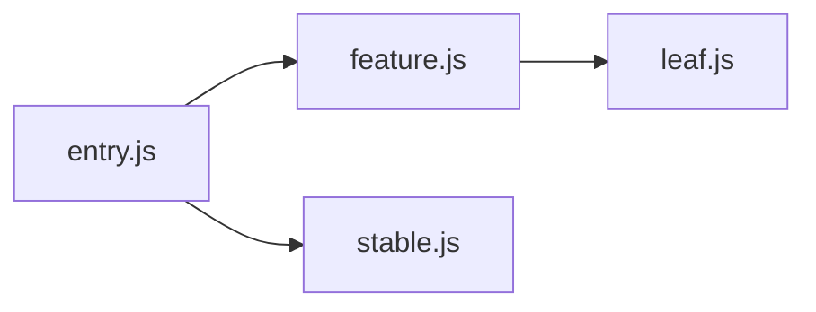
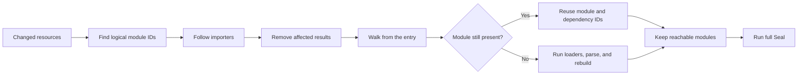
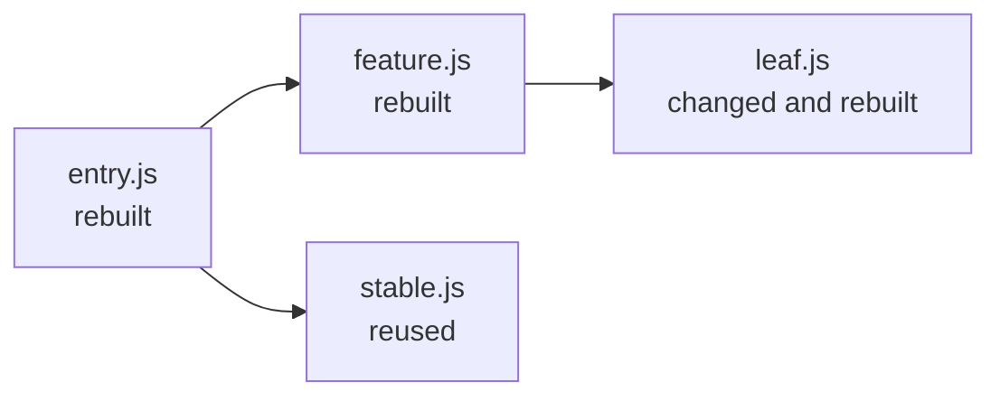

## A changed file is not an invalidation model

At the end of [the watch mode chapter](/posts/feopack-watch-mode/), Feopack could keep running, collect changed and removed file paths, and start another build at the right time.

It also threw away every useful result from the previous build.

That made the next feature sound deceptively mechanical:

```text
if a file did not change:
  do not rebuild it
```

But what exactly is “it” in that sentence?

A file is not always a module. A module may be created from a file plus a query, a particular loader chain, or a virtual request generated by another loader. And even if one module changes, the compiler may no longer be able to trust the modules that imported it.

Incremental compilation therefore begins with a question about evidence, not speed:

> Why are we allowed to reuse this result?

:::commit-trail{title="Implementation snapshot · 1 commit"}
- [`4dab860`](https://github.com/atom-universe/feopack/commit/4dab860f99363574f82bd9929c1313bc92406cb5) — preserve the previous module graph, invalidate affected modules, rebuild from the entry, and reuse an unaffected branch
:::

> This chapter describes a deliberately small incremental `make`. It is not a claim that every compiler phase became incremental in one commit.

## 1. What did the watcher actually tell us?

The JavaScript scheduler already had two sets:

```ts
compiler.modifiedFiles = new Set(changedFiles)
compiler.removedFiles = new Set(removedFiles)
```

Those values crossed NAPI through a new native `rebuild(modifiedFiles, removedFiles)` method. That solved the transport problem. It did not yet tell Rust which module records were unsafe to reuse.

My first instinct was to look up each path in the module graph and remove the matching module. That would have worked in the earliest version of Feopack. By this point, it was already the wrong model.

Consider a single-component file:

```text
/src/App.meow-v3
/src/App.meow-v3?type=script&lang=ts
/src/App.meow-v3?type=style&scoped
```

The three strings can identify three logical modules, while every one of them reads from the same physical resource. If `/src/App.meow-v3` changes, looking it up in a map keyed only by module ID will miss the virtual blocks.

Earlier Feopack code had used a file path as the module identity. The loader chapters broke that convenient equivalence for a good reason: a request ID can preserve queries and inline loader syntax that an operating-system path cannot represent.

Now the file path had to return, but in a different role.

## 2. Bringing file paths back without making them identities

The module graph kept its primary map keyed by module ID and added a secondary index:

```rust
pub struct ModuleGraph {
  modules: HashMap<String, Module>,
  modules_by_resource: HashMap<PathBuf, HashSet<String>>,
  incoming_modules: HashMap<String, HashSet<String>>,
}
```

The distinction is small enough to fit in one table:

| Value | Answers | Example |
| --- | --- | --- |
| module ID | Which logical module is this? | `/src/App.meow-v3?type=script&lang=ts` |
| resource path | Which physical input did it read? | `/src/App.meow-v3` |
| incoming modules | Who depends on this module? | `entry.js`, `page.js` |

The first index answers the watcher's question:

```text
changed resource path -> one or more logical module IDs
```

This looked suspiciously like the old `filePath -> module` design returning to the project, but the multiplicity changes its meaning. It is no longer identity. It is an invalidation index.

That difference protects the virtual-module model instead of quietly undoing it.

## 3. Why is finding the changed module not enough?

Suppose the graph looks like this:



When `leaf.js` changes, Feopack certainly distrusts `leaf.js`. The first implementation also distrusts `feature.js` and `entry.js`, because they sit on paths that lead to the changed module. `stable.js` has no such path and remains reusable.

To walk in that direction, the graph needs the reverse of an import list:

```text
normal edge:   importer -> dependency
reverse index: dependency -> importers
```

`affected_modules()` starts with the logical modules backed by changed resources and follows `incoming_modules` until it reaches no new importers.

```rust
while let Some(module_id) = queue.pop_front() {
  let Some(importers) = self.incoming_modules.get(&module_id) else {
    continue;
  };

  for importer in importers {
    if affected.insert(importer.clone()) {
      queue.push_back(importer.clone());
    }
  }
}
```

Is rebuilding every importer always necessary? No.

If only the implementation inside `leaf.js` changed and its identity stayed stable, the generated factory for `feature.js` might be byte-for-byte identical. A more precise compiler could distinguish changes to source, exports, dependency structure, loader results, and code-generation inputs.

Feopack did not yet have those proofs. I chose the conservative walk because it made that uncertainty explicit: it reused less work than theoretically possible, but it did not pretend to know that an importer was unaffected.

## 4. Should a rebuild reuse the old `Compilation`?

The watch implementation had taught Feopack to create a fresh `Compilation` for every cycle. Incremental work seemed to contradict that design. If the old compilation disappears, where can its useful results live?

Rspack's architecture suggests a better distinction: a compilation can be new while selected artifacts survive it.

Feopack adopted the smallest version of that idea. `Compiler::rebuild()` creates the next compilation, then moves two pieces of completed work out of the previous one:

```rust
self.module_graph = std::mem::take(&mut previous.module_graph);
self.module_sources = std::mem::take(&mut previous.module_sources);
```

The next lifecycle remains fresh. The graph and transformed module sources become reusable inputs.

One tempting cache was deliberately left behind:

```rust
// file_source_cache 只属于一次 Compilation。跨轮复用的是已经完成
// loader 和解析的模块结果，而不是未经校验的磁盘内容。
```

Reusing raw file contents would require its own validity rule. Keeping the cache per-compilation avoided adding a second invalidation system while the first one was still being taught.

This produced a useful ownership rule:

> Reuse finished artifacts whose dependencies we can name; discard transient caches whose validity we cannot yet prove.

## 5. How do we rebuild only what we distrust?

At the start of `make`, Feopack converts changed resources into logical module IDs, follows the importer closure, and removes the affected modules and their transformed sources.

It then walks forward from the entry again.



The forward walk is doing more than filling holes. It asks whether the old graph is still reachable from the current entry.

If a rebuilt importer no longer references one of its old dependencies, that dependency may remain in the carried-over graph even though nothing can reach it. After the walk, Feopack retains only the visited module IDs:

```rust
self.module_graph.retain_modules(&visited);
self
  .module_sources
  .retain(|module_id, _| self.module_graph.has_module(module_id));
```

This matters for deletion in two different senses. If an imported file disappears but the request remains, rebuilding should fail honestly. If an import statement disappears, the old target should become an orphan and leave the graph.

## 6. What survives the second walk?

The test fixture made the boundary visible with four modules:



After changing `leaf.js`, the rebuild reported:

```text
[Rust Make] 失效模块：3，重新构建：3，复用：1
```

The three affected modules were `leaf.js`, `feature.js`, and `entry.js`. The separate `stable.js` branch survived.

The test then removed the import of `leaf.js` from `feature.js` and rebuilt again. The reachability pass removed `leaf.js` from the graph, and the generated bundle no longer contained its old source.

Those checks prove more than “the output changed.” They prove that one branch was reused and that stale graph state did not remain merely because it came from a previous compilation.

Still, the counters are diagnostic evidence, not a performance benchmark. On a four-module fixture, allocating indexes and calculating invalidation can cost more than rebuilding everything. The mechanism becomes valuable only when the avoided work is expensive enough.

## 7. Why did `seal` still start over?

Feopack made `make` incremental and left `seal` complete:

```text
incremental make
  -> complete chunk graph
  -> complete code generation
  -> complete asset emission
```

That boundary was deliberate. Feopack still had one chunk, a small runtime, and no mutation model for chunk membership or generated assets. Reusing the module graph was already enough to teach invalidation without simultaneously inventing incremental code generation.

There is a useful warning in [Rspack's current `build_chunk_graph` source](https://github.com/web-infra-dev/rspack/blob/f4f0352e53e57f475566d4ac4a2dbb4a93ee5f28/crates/rspack_core/src/compilation/build_chunk_graph/mod.rs#L13-L23). The implementation contains an incremental code path, but the heuristic is temporarily disabled and the splitter currently begins with `Default::default()`:

```rust
let enable_incremental = false;
let mut splitter = if enable_incremental {
  std::mem::take(&mut compilation.build_chunk_graph_artifact.code_splitter)
} else {
  Default::default()
};
```

When I first saw `Default::default()`, it looked like evidence that Rspack was simply starting over. That reading was too broad. The snippet does **not** mean Rspack's whole rebuild is non-incremental. Its module graph, factorization data, dependency counters, mutations, and other compilation artifacts have separate reuse rules. It means one phase can choose a complete recomputation even while earlier and later parts of the compiler carry incremental state.

This is the lesson Feopack borrowed, not the implementation:

> “Incremental” is not one switch on the compiler. It is a validity decision made at each phase boundary.

For this version, `make` had a validity model. `seal` did not. Starting `seal` from a clean state was therefore the more honest choice.

## 8. What does this version deliberately ignore?

The implementation is useful, but its trust model is narrow.

- It tracks files that successfully became modules, not context dependencies, missing dependencies, configuration files, or loader-declared dependencies.
- It treats a changed resource conservatively and rebuilds every importer, even when their generated code might remain identical.
- It does not hash rebuilt output to discover that a filesystem event produced no semantic change.
- It reuses transformed module results as a unit. It does not cache resolution, loader execution, parsing, and code generation independently.
- It performs a complete `seal` and emits the whole bundle again.
- It does not yet explain invalidation caused by plugin state, environment variables, compiler options, or non-file inputs.

These are not decorative TODOs. Each missing input is another way a cached result could become false while the compiler continued to trust it.

The danger of such a list is that it can make the missing pieces sound like routine polish. They are not. Context dependencies change what the watcher can observe. Loader dependencies change which inputs belong to a module. Incremental `seal` requires a mutation model for chunks and assets. Each addition would widen the set of results Feopack could safely preserve.

I stopped at incremental `make` because it was the first boundary the project could explain honestly. Extending the cache before extending that explanation would make the compiler faster at believing stale information.

## 9. What had Feopack learned to remember?

Watch mode made the compiler repeat itself. Incremental `make` forced it to remember.

Before this commit, every new `Compilation` was a clean slate. Afterwards, a fresh lifecycle could carry an old module graph forward, remove the parts invalidated by physical changes, and reuse a branch that remained both unaffected and reachable.

That changed how I understood the feature. I had been treating incremental compilation as a cache: if the file looked the same, keep the old result. The implementation turned that shortcut into an argument. A module could survive only when its resource was unchanged, no invalidated dependency reached it, and the new entry walk could still reach it.

The argument is still conservative and incomplete, but at least it can be challenged. What about a loader reading a second file? What about a plugin consulting an environment variable? What about a change that leaves the generated module identical? Those questions now have somewhere to attach.

And then a rather tempting thought appears: if the compiler can rebuild only part of the graph, is HMR nearly finished?

> Can it replace only that code without throwing away the whole page?

Not quite. The server can remove a module record and build a new one because its graph is only data. The browser has already executed the old module. It may have registered listeners, created timers, mutated state, or handed values to importers. Replacing its code requires another validity model: who accepts the update, what must be disposed, and when should the runtime give up and reload the page?

That is the next experiment. Apparently, once a compiler learns what to remember, the next challenge is teaching the runtime what it is allowed to forget.
