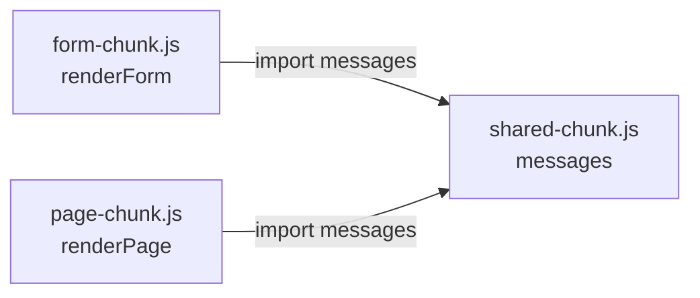
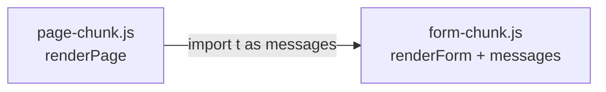
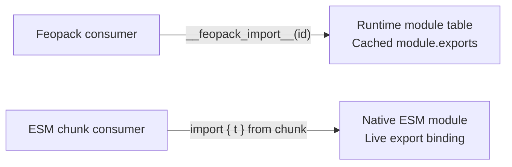
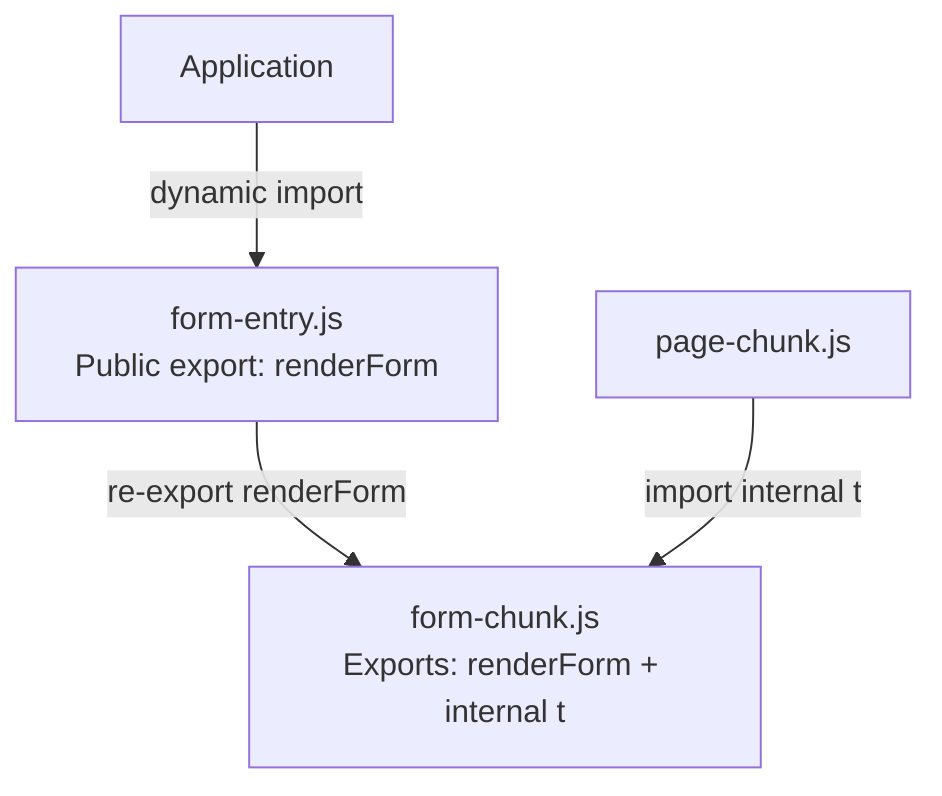

I originally planned to leave code splitting for a later chapter. Feopack still puts every module into one chunk, and there were other parts of the compiler I wanted to explore first.

But recently, while reading bundler implementations and looking for opportunities to contribute, I came across [Rolldown issue #11397](https://github.com/rolldown/rolldown/issues/11397). A dynamic import was returning an extra export that the original module had never declared.

That gave me a reason to bring this chapter forward. Before thinking about a fix, I needed to understand why the bundler had generated that export in the first place.

In [the previous chapter](/posts/feopack-incremental-builds/), incremental `make` reached a small but useful milestone: Feopack could invalidate affected modules, rebuild them, and reuse an unaffected part of the module graph. `seal()` still ran from scratch, and the chapter ended by looking ahead to HMR.

This time, I want to return to `seal()` instead.

Back when [Feopack first produced a working bundle](/posts/feopack-from-source-to-bundle/), we introduced a `ChunkGraph`, but its construction was deliberately simple:

```rust
let module_ids = self.module_graph.module_ids().cloned().collect();

let chunk = Chunk {
  id: "main".to_string(),
  module_ids,
};
```

Every discovered module went into `main`. The runtime then gave each module its own exports object and let other modules access it through `__feopack_import__(moduleId)`. That remains the basic arrangement in [Feopack's chunk construction](https://github.com/atom-universe/feopack/blob/main/crates/feopack-core/src/compiler/compilation/seal/chunk_graph.rs).

Several modules could already share a dependency. So why would another bundler need to generate this?

```js
export { messages as t };
```

What did that extra export do that Feopack's module table did not?

To answer that, let's give the dependency graph more than one output chunk. This will explain one concrete case rather than every rule in Rolldown's chunking algorithm.

Suppose our source contains these three modules:

```js
// messages.js
export const messages = { title: 'Hello' };

// form.js
import { messages } from './messages.js';

export function renderForm() {
  return messages.title;
}

// page.js
import { messages } from './messages.js';

export function renderPage() {
  return messages.title;
}
```

The application loads the form and page through separate dynamic imports.

The first layout I imagined was a dedicated shared chunk. In these diagrams, arrows point from the consumer to the module or chunk it depends on:



That arrangement is easy to follow. Both consumers import the shared value from a third output file.

But "shared dependency" does not automatically mean "separate shared file." Another possible arrangement is:



These are illustrative layouts, not a claim that the small example must produce either one under every configuration. The actual decision depends on the dependency graph and chunking rules.

At this point, a natural question is whether users can influence those decisions. They can: Rolldown's [`output.codeSplitting`](https://rolldown.rs/in-depth/manual-code-splitting) option provides manual grouping rules, including ways to select modules for named chunks.

There is also a related decision: what may an entry chunk expose after modules have been grouped together?

That is what [`preserveEntrySignatures`](https://rolldown.rs/reference/InputOptions.preserveEntrySignatures) controls. *Preserve* means to keep something intact; here, the entry signature is its public export interface.

| Setting | Policy for entry exports |
| --- | --- |
| `'strict'` | Keep the original exports exactly, without additional internal exports. |
| `'allow-extension'` | Keep the original exports, but allow additional exports. |
| `'exports-only'` | Use strict behavior for entries with exports; allow extension for entries without exports. This is the default. |
| `false` | Do not require the entry's original export interface to be retained. |

For example, a configuration can request a strict entry interface:

```js
export default {
  input: 'src/main.js',
  preserveEntrySignatures: 'strict',
  output: {
    dir: 'dist',
    format: 'esm',
  },
};
```

The distinction matters: chunk grouping controls where modules go; signature preservation constrains what entry consumers can see. The latter can require a forwarding chunk, but it does not directly select one of our two layouts. Nor does setting it to `'strict'` fix every namespace bug, as the reported dynamic-import case will show.

For now, suppose we get the second layout.

Inside `form-chunk.js`, the function and the value it uses now live together:

```js
const messages = { title: 'Hello' };

function renderForm() {
  return messages.title;
}
```

The source-level import between those modules no longer needs to remain as a file-level import. `renderForm` can directly access the binding.

`renderPage`, however, lives in another output file. It needs a way to reach that same binding. The bundler can generate a connection:

```js
// form-chunk.js
export { renderForm, messages as t };
```

```js
// page-chunk.js
import { t as messages } from './form-chunk.js';

function renderPage() {
  return messages.title;
}

export { renderPage };
```

Now the extra export has a clear consumer.

The `export` makes the binding accessible from another chunk. The `import` accesses it. The alias `t` is only a generated name; it does not perform sharing or deduplication. Exporting the binding as `messages` would work too.

This was where my Feopack comparison had been misleading me. Feopack already had a communication mechanism: its runtime looked up a module by ID and returned that module's exports. In this ESM output, native imports and exports connect the output files.



Both arrangements let consumers access a shared dependency. They preserve module boundaries in different ways.

It also helped to locate this work inside the compiler. Feopack's `seal()` builds the chunk graph and generates assets. Rolldown's [`GenerateStage`](https://github.com/rolldown/rolldown/blob/2a53ec71548752402c3db1c0435cdd32fdf1131d/crates/rolldown/src/stages/generate_stage/mod.rs) has broadly similar responsibilities, with considerably more analysis and planning between those steps.

One small naming detail helped me read this code: `meta` is short for *metadata*, not a Rust keyword; here, it holds flags describing an entry chunk, such as whether it is user-defined, dynamically imported, or emitted by a plugin.

The name `GenerateStage` initially made me think mainly of printing code. But deciding which bindings must cross chunk boundaries is part of preparing that code. Once the compiler has placed modules into chunks, it must rebuild the connections that the new layout requires.

The source imports describe relationships between source modules. The generated imports describe relationships between output chunks.

Those relationships do not have to correspond one-to-one.

That explains why the extra export exists. It does not yet explain the bug.

In our simplified example, an application importing the original form module expects this:

```js
const form = await import('./form.js');

Object.keys(form);
// ['renderForm']
```

If the bundler rewrites that call directly to the combined chunk:

```js
const form = await import('./form-chunk.js');
```

the JavaScript engine sees the exports of the file it actually loads:

```js
Object.keys(form);
// ['renderForm', 't']
```

It has no knowledge of the original boundary between `messages.js` and `form.js`. Both names are exports of `form-chunk.js`.

The real Rolldown report followed this pattern. A form module and its translation dependency ended up in one chunk, while another chunk needed the translations. The generated chunk exposed an internal alias, and a bare dynamic import returned that alias alongside the form's public exports.

This mattered because the application enumerated the imported namespace and interpreted its exports as form definitions. An internal binding became an unexpected application value. The issue included a reproduction using default options in Rolldown 1.2.16; explicitly setting `preserveEntrySignatures: 'strict'` still exposed the extra export. This was not a case of the user opting into `'allow-extension'`. [Original report and reproduction](https://github.com/rolldown/rolldown/issues/11397)

The internal export itself had a legitimate purpose. Removing it would break the other chunk's access to the shared value.

What needed protection was the interface returned to the dynamic importer.

This brings us back to the entry-signature policies from earlier. The distinction between a chunk's internal communication needs and an entry's public interface is now visible in the generated code.

An output chunk may need additional exports for communication. That does not automatically make those names part of the original module's public interface.

There are different ways to maintain that distinction.

In the issue's comparison, Rollup kept a representation of the original module's namespace inside the chunk and rewrote the dynamic import to select it:

```js
// Conceptual shape; names simplified.
import('./form-chunk.js').then(chunk => chunk.formNamespace);
```

The report also showed that Rolldown already used namespace extraction for some other dynamic-entry layouts. This case did not take that path.

Another approach is a small forwarding module, often called a *facade*. For our simplified example, it could look like this:

```js
// form-entry.js
export { renderForm } from './form-chunk.js';
```

The application dynamically imports `form-entry.js`. Other chunks can still import internal bindings from `form-chunk.js`.



That is the direction of the [patch I have been exploring](https://github.com/rolldown/rolldown/compare/main...CoderSerio:rolldown:fix/dynamic-import-namespace): reuse Rolldown's [existing entry-facade machinery](https://github.com/rolldown/rolldown/blob/2a53ec71548752402c3db1c0435cdd32fdf1131d/crates/rolldown/src/stages/generate_stage/entry_facades.rs) for affected dynamic entries. As of November 1, 2026, this is an experimental patch that has not landed upstream.

There is a visible tradeoff. In our reproduction, the facade approach produces four JavaScript files instead of three. Rollup's namespace-extraction approach keeps three. Correct exports are essential, but the extra file is still something to evaluate.

The namespace also has to preserve behavior, not just names. A normal object literal can capture the current value of a mutable export. ESM re-exports retain live bindings, which is one reason reusing the existing export machinery is attractive.

The regression therefore checks more than `Object.keys()`: it also updates an exported variable, imports the module again, and verifies that the other chunk can still use the shared data.

Feopack's single-chunk runtime let me postpone these questions. Reading the Rolldown issue made them concrete: after modules are placed into separate output files, the compiler needs to connect those files while preserving the interfaces that source-level imports refer to.

For this chapter, I wanted to understand that boundary through an existing bundler. In the next chapter, I'll return to Feopack and explore a minimal code-splitting implementation of our own.
